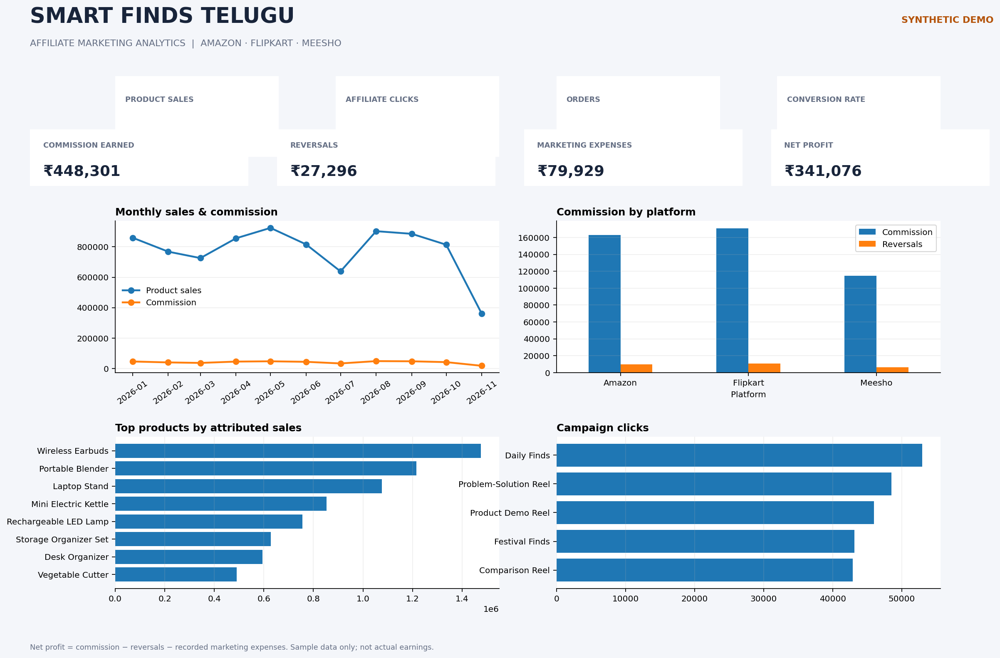

# Smart Finds Telugu — Affiliate Marketing Analytics Dashboard



An interactive portfolio project built with **Python, Streamlit, Pandas and NumPy** to analyze affiliate marketing performance across Amazon, Flipkart and Meesho.

> **Important:** The included data is synthetic sample data generated for demonstration. It is not actual Smart Finds Telugu clicks, orders, sales, commissions or earnings. Commission assumptions are illustrative and are not official platform rates.

## Features

- KPI cards for attributed product sales, affiliate clicks, orders and conversion rate.
- Commission earned, reversals, marketing expenses, net commission and net profit.
- Date range, platform, product and campaign filters.
- Monthly sales and commission trends.
- Platform commission comparison.
- Top products by attributed sales.
- Campaign click and order analysis.
- Product-level performance table.
- Upload your own affiliate CSV and download filtered data.

## Project structure

```text
Smart-Finds-Telugu-Affiliate-Dashboard/
├── app.py
├── requirements.txt
├── README.md
├── .gitignore
├── assets/
│   └── dashboard_preview.png
├── data/
│   └── sample_affiliate_data.csv
├── src/
│   ├── __init__.py
│   └── analysis.py
└── tests/
    └── test_analysis.py
```

## Run locally on Windows

1. Install Python 3.10 or later from https://www.python.org/downloads/.
2. Extract this ZIP file.
3. Open the extracted project folder.
4. In File Explorer, click the address bar, type `cmd`, and press Enter.
5. Run:

   ```bash
   python -m venv .venv
   .venv\Scripts\activate
   pip install -r requirements.txt
   streamlit run app.py
   ```

6. The dashboard opens in your browser, usually at `http://localhost:8501`.

## Upload your own affiliate data

Use the file uploader in the left sidebar. The CSV must contain these columns:

`Date, Platform, Product, Category, Campaign, Clicks, Orders, Sales_INR, Commission_Earned_INR, Reversals_INR, Marketing_Expenses_INR`

Dates should be parseable (recommended: `YYYY-MM-DD`). Amounts should be numeric INR values. Use zero for expenses or reversals when none apply.

## Metric definitions

- **Product sales:** attributed order value. It is not your income.
- **Commission earned:** commission amount reported or entered.
- **Reversals:** commission removed due to returns, cancellations or rejected orders.
- **Net commission:** commission earned minus reversals.
- **Marketing expenses:** recorded advertising, promotion and content costs.
- **Net profit:** net commission minus recorded marketing expenses. This is a simplified contribution measure before tax and unrecorded costs.
- **Conversion rate:** orders divided by clicks, multiplied by 100.

Actual attribution, rates, reporting fields and payment status vary by affiliate platform. Use platform reports as the source of truth.

## Technologies

Python · Streamlit · Pandas · NumPy · Matplotlib · CSV

## GitHub repository description

Interactive affiliate marketing analytics dashboard built with Python and Streamlit to track clicks, orders, product sales, commissions, reversals, expenses and net profit across Amazon, Flipkart and Meesho.
